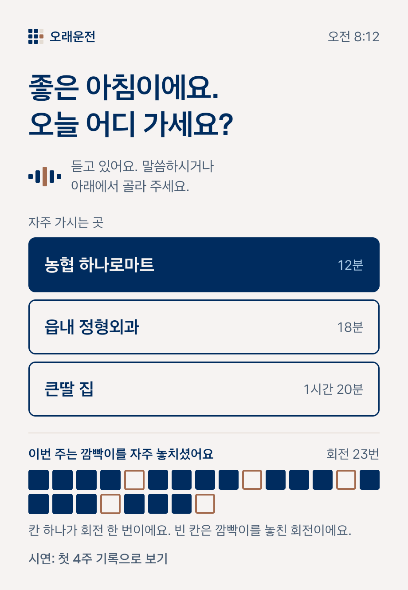
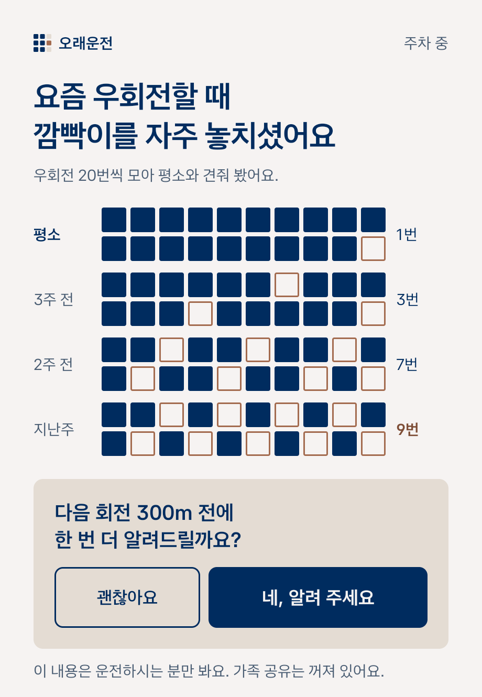
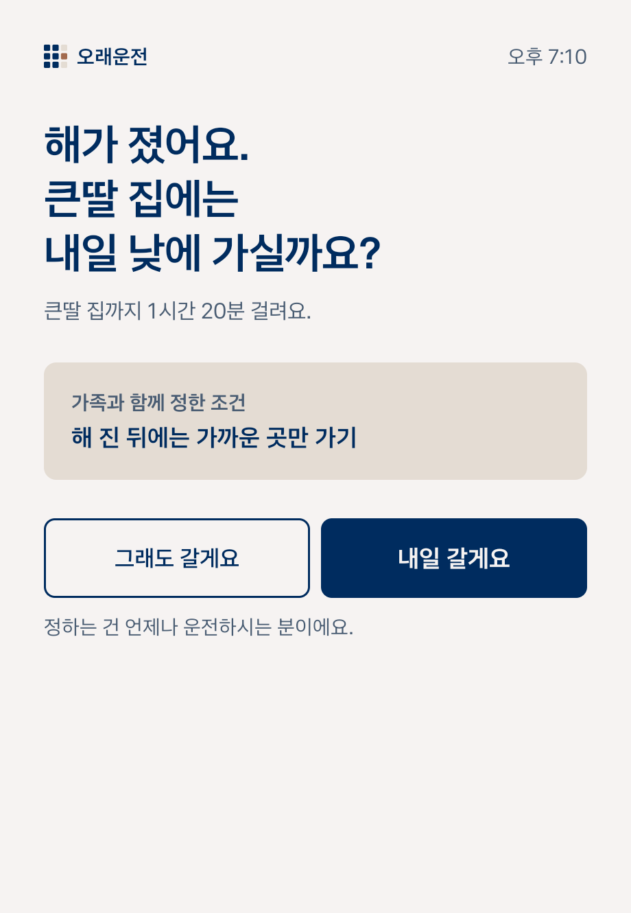
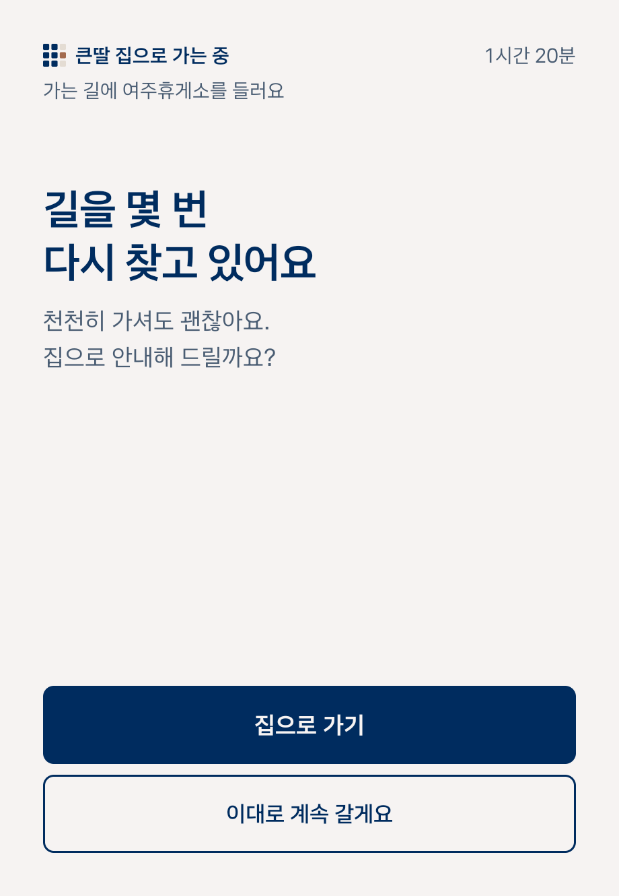
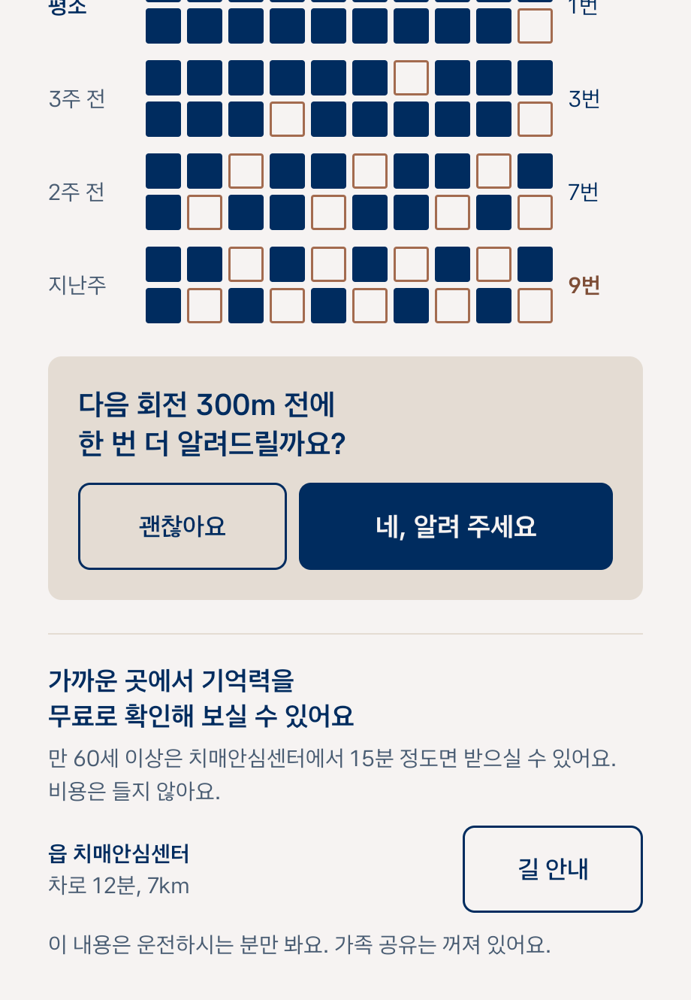
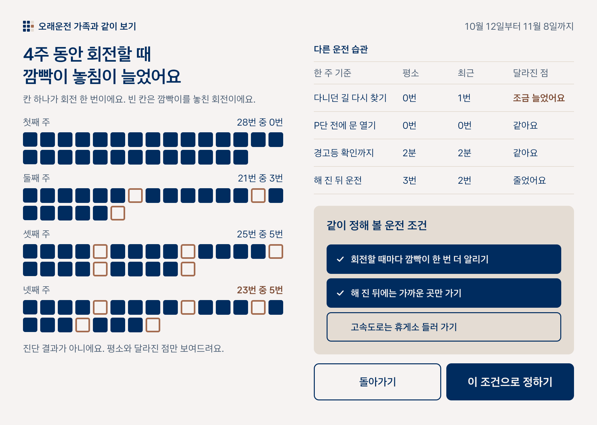
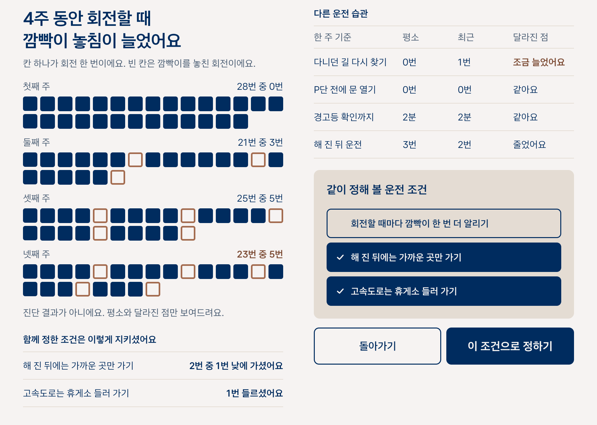

# 오래운전

**부모님 차가 먼저 알아채는 운전 컨디션 변화.**
고령 운전자를 위한 Pleos Connect 차량 앱. 차량 신호로 깜빡이 누락 같은 "깜빡함"의 변화를 본인 기준으로 알아채고, 본인이 동의한 가족과 함께 어떤 조건에서 계속 운전할지 정하고 지키도록 돕는다.

> 2026 현대자동차그룹 차량용 앱 개발 공모전 "Code your App into Pleos App Market" 출품작, 팀 봇듀

**[시연 영상 보기 (70초)](docs/demo.mp4)** · [APK 받기](apk/봇듀_오래운전_release.apk) · [개발일지](docs/개발일지.md)

<p>





</p>



<sub>Pleos Connect 앱 창 크기(세로 1칸 920×1330, 가로 2칸 1870×1330)로 맞춘 에뮬레이터에서 찍은 실제 실행 화면</sub>

## 왜 만들었나

| 사실 | 출처 |
| --- | --- |
| 65세 이상 운전자 교통사고 2025년 4만 5,873건, 2021년 대비 44% 증가 | 경찰청 집계 ([매일신문 2026.10.10](https://www.imaeil.com/page/view/2026101006531725206)) |
| 고령 운전자 면허 반납률 2021년 2.09%, 2025년 2.51%. 5년째 2%대 | 경찰청 자료 (같은 보도) |
| 야간·고속도로 운전을 제한하는 조건부 면허를 2027년 하반기 목표로 검토 중 | 경찰청 (같은 보도) |

반납만으로는 풀리지 않는다. 이동이 생계와 이어진 사람이 많기 때문이다. 질문은 "반납하느냐"가 아니라 "어떤 조건에서 계속 운전하느냐"로 바뀌고 있다. 그런데 지금 판단 도구는 3년에 한 번 받는 인지능력 자가진단뿐이고, 실제 운전 행동은 보지 않는다.

## 무엇을 하나

| 기능 | 내용 |
| --- | --- |
| 출발 인사 | 시동을 걸면 "오늘 어디 가세요?"라고 묻고, 답하면 목적지가 정해진다 |
| 나만의 기준선 | 처음 4주가 본인의 평소. 그다음은 평소보다 달라졌을 때만 본인에게 먼저 알린다 |
| 깜빡이 알림 | 본인이 수락하면 회전 200m 앞에서 "오른쪽 깜빡이를 켜 주세요" |
| 가족과 같이 보기 | 가족이 동승했을 때 주차 중에 최근 4주 기록을 함께 보고 운전 조건을 정한다 |
| 조건이 작동 | 해 진 뒤 먼 곳이면 "내일 낮에 가실까요?", 고속도로는 휴게소를 경유지로. 막지 않고 제안만 한다 |
| 조건 지킨 기록 | 다음에 가족과 볼 때 "2번 중 1번 낮에 가셨어요"처럼 함께 정한 조건을 지킨 횟수를 보여준다 |
| 길 헤맴 감지 | 늘 다니던 길에서 경로를 몇 번 다시 찾으면 "집으로 안내해 드릴까요?" |
| 다음 할 일 잇기 | 변화를 알린 뒤 만 60세 이상이면 가까운 치매안심센터의 무료 검사를 알리고 길 안내를 열어 둔다 |

칸 하나가 회전 한 번이다. 채운 남색 칸은 깜빡이를 켠 회전, 금색 테두리만 있는 빈 칸은 놓친 회전이다. 색과 모양 둘 다로 구분된다.

**왜 휴대폰이 아니라 차여야 하나**: 방향지시등, 기어, 문, 경고등 신호는 차 안에서만 정확히 얻을 수 있고, 내비 회전 안내와 실제 조작을 같은 시각에 맞춰 볼 수 있는 곳은 차량 OS뿐이다. 단말기를 달거나 휴대폰을 켤 필요 없이 시동만 걸면 동작한다.

## 판정 규칙

판정은 화면과 분리된 엔진(`app/src/main/java/com/botdue/orae/engine/`)이 한다. 모든 규칙에 단위 테스트가 있다.

1. **깜빡이 누락**: 내비가 회전을 안내하고(`NaviHelper onTBTInfo`) 90초 안에 같은 방향으로 회전했을 때, 회전 직전 10초 안에 같은 방향 깜빡이(`Vehicle TurnSignal`)가 켜지지 않았으면 놓침. 안내 없는 회전은 판정하지 않는다.
2. **나만의 기준선**: 처음 4주 기록이 평소. 남과 비교하거나 점수로 판정하지 않는다.
3. **변화**: 최근 3주가 모두 평소보다 높고, 지난주가 평소보다 10%p 이상 높을 때만 알린다. 한 주만 튀는 것은 변화로 보지 않는다.
4. **조건 적용**: "해 진 뒤에는 가까운 곳만"이면 18~6시에 10km가 넘는 출발에 낮에 가기를 제안한다. "고속도로는 휴게소 들러 가기"면 첫 휴게소를 경유지로 넣는다. 제안마다 제안대로 했는지(낮에 가기를 골랐는지, 휴게소를 지나 도착했는지)를 남겨 조건별로 센다. 지키지 않은 것을 탓하지 않고 횟수만 보여준다.
5. **길 헤맴**: 이 목적지로 5번 이상 다녀온 길에서 5분 안에 경로 재탐색(`onReRouteEnded`)이 2번 나오면 집 안내를 제안한다.
6. **다음 할 일**: 3번의 변화가 있고 운전자가 만 60세 이상이면 가장 가까운 치매안심센터 한 곳을 제안한다. 만 60세 이상은 소득과 상관없이 인지선별검사가 무료다. 가라고 권하지 않고 길만 열어 둔다.

## 구조

```
app/src/main/java/com/botdue/orae/
├── engine/                        판정 엔진 (화면과 분리, 단위 테스트 대상)
│   ├── DriveSignal.kt             차량 신호 모델: 회전 안내, 방향지시등, 회전 통과
│   ├── MissedTurnSignalDetector   깜빡이 누락 판정 (집중잔량과 공유)
│   ├── Baseline.kt                나만의 기준선과 변화 판정
│   ├── Conditions.kt              함께 정한 조건을 출발에 적용, 지킨 기록
│   ├── WanderingDetector.kt       길 헤맴 감지
│   ├── NextStep.kt                변화 다음 할 일 (무료 검사 안내)
│   └── VehicleSignalSource.kt     신호 공급원 인터페이스와 시연용 데이터
├── ui/                            Jetpack Compose 화면 (현대차 CI 색, Asta Sans, 고령자용 큰 글씨)
└── MainActivity.kt                화면 흐름
```

### Pleos SDK 연결 계획

| 신호 | API |
| --- | --- |
| 방향지시등 | `TurnSignal.registerTurnSignalState()` |
| 회전 안내, 경로 재탐색 | `NaviHelperEventListener.onTBTInfo()`, `onReRouteEnded()` |
| 문, 경고등, 전조등 | `Door.registerDoorPosition()`, `Safety.registerTelltales()`, `Light.registerLowBeamLightState()` |
| 기어(P단), 주차 브레이크, 차속 | AAOS `CarPropertyManager` (GEAR_SELECTION, PARKING_BRAKE_ON, PERF_VEHICLE_SPEED) |
| 출발 인사, 깜빡이 알림 | STT / TTS |
| 휴게소 경유 | NaviHelper 경유지·경로 옵션 |
| 가까운 치매안심센터 | 공공데이터포털 [전국치매센터표준데이터](https://www.data.go.kr/data/15021138/standard.do) (위도·경도), 길 안내는 NaviHelper |

`VehicleSignalSource` 를 구현한 `PleosSignalSource` 를 추가하면 화면과 엔진은 그대로 쓴다.

## 실행

```bash
adb install apk/봇듀_오래운전_release.apk   # Pleos Connect Emulator(AAOS)
./gradlew :app:testDebugUnitTest            # 판정 엔진 테스트 23개
./gradlew :app:assembleRelease              # APK 빌드 (JDK 17)
```

차량 신호는 아직 시연용 주행 데이터로 재생한다. 시연에 쓰는 버튼은 다음과 같다.

- 출발 화면 아래: "첫 4주 기록 / 7주째 기록", "아침 출발 / 저녁 출발" 전환
- 주행 화면: "길 벗어나기"(경로 재탐색 대신), "도착했어요"(기어 P 신호 대신)

## 현재 상태

- [x] 화면 6종과 판정 엔진, 단위 테스트 17개 (v0.1.0)
- [x] Pleos 앱 창 크기 에뮬레이터에서 동작 확인, 시연 영상
- [x] 변화 다음 할 일: 가까운 치매안심센터 무료 검사 안내, 테스트 21개 (v0.2.0)
- [x] 조건 지킨 기록, 테스트 23개 (v0.3.0)
- [ ] Pleos Connect Emulator에서 SDK 콜백 연결 (`PleosSignalSource`)
- [ ] STT·TTS 음성, 휴게소 경유지 실제 설정, 로컬 DB 저장
- [ ] 몇 주치 주행을 빠르게 재생하는 시연 도구 (2차 PT용)

자세한 진행은 [개발일지](docs/개발일지.md)에 있다.

## 원칙

- 운전 기록은 차 안에만 저장한다. 가족 공유는 본인이 켰을 때만 한다.
- 운전 습관의 변화를 보여줄 뿐 의학적 진단이 아니다. "진단", "판정" 같은 말은 화면에 쓰지 않는다.
- 운전을 막지 않는다. 제안만 하고, 고르는 건 언제나 운전자 본인이다.

## 라이선스

글꼴 Asta Sans: SIL Open Font License 1.1
