<div align="center">

# 오래운전

**부모님 차가 먼저 알아채는 운전 컨디션 변화.**

고령 운전자를 위한 Pleos Connect 차량 앱


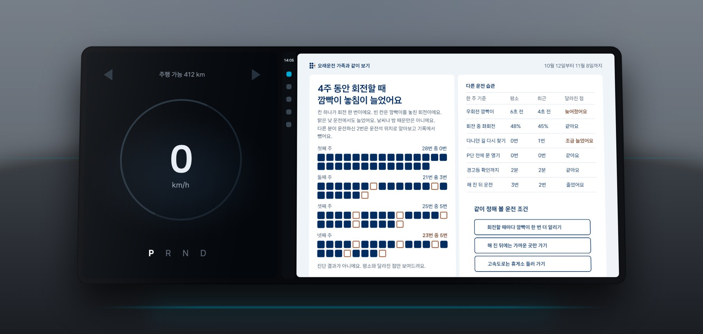

[움직이는 장면](#움직이는-장면) · [**시연 영상 (70초, v0.4.0 화면)**](docs/demo.mp4) · [APK 받기](apk/봇듀_오래운전_release.apk) · [개발일지](docs/개발일지.md) · [시스템 구조](#시스템-구조)

</div>

> [!NOTE]
> 2026 현대자동차그룹 차량용 앱 개발 공모전 "Code your App into Pleos App Market" 출품작, 팀 봇듀.
> 차량 신호는 아직 시연용 주행 데이터로 재생한다. Pleos SDK 콜백 연결은 [현재 상태](#현재-상태)에 적었다.

## 한눈에 보기

| | |
| --- | --- |
| 누구를 위해 | 계속 운전해야 하는 고령 운전자와, 함께 살피고 싶은 가족 |
| 무엇을 보나 | 내비 회전 안내 대비 깜빡이 누락, 늘 다니던 길에서의 경로 재탐색 |
| 무엇을 해 주나 | 처음 4주를 평소로 삼아 달라졌을 때만 본인에게 먼저 알리고, 가족과 함께 정한 운전 조건이 출발할 때 작동한다 |
| 무엇을 하지 않나 | 진단·점수·운전 금지. 제안만 하고 고르는 건 운전자 본인 |
| 데이터 | 차 안에만 저장. 가족 공유는 본인이 켰을 때만 |

## 차 안에서 이렇게 보인다

<table>
<tr>
<td width="50%">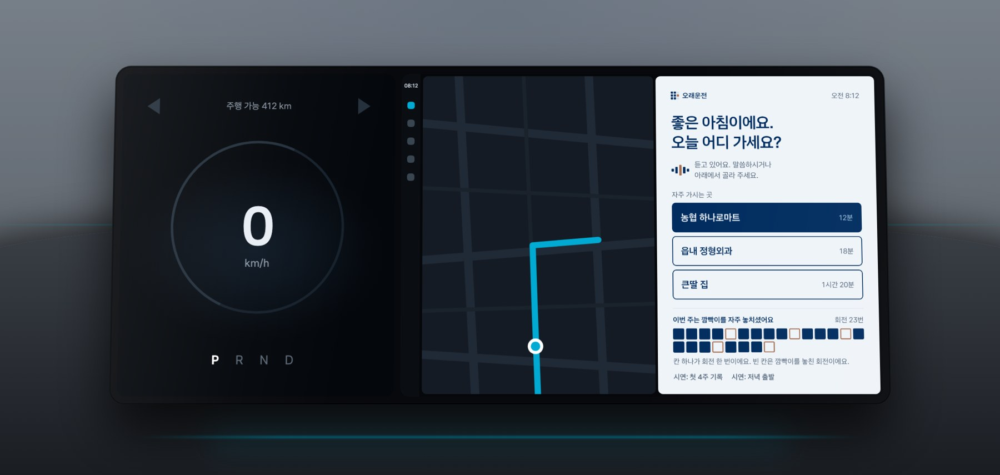</td>
<td width="50%">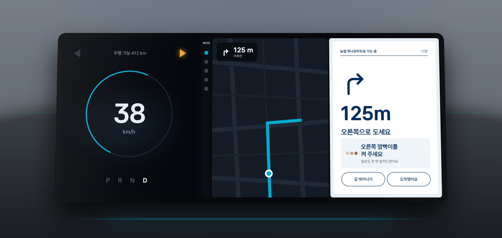</td>
</tr>
<tr>
<td><b>출발 인사</b><br>시동을 걸면 "오늘 어디 가세요?" 자주 가는 곳을 크게 보여준다</td>
<td><b>주행 중</b><br>본인이 수락하면 회전 200m 앞에서 "오른쪽 깜빡이를 켜 주세요"</td>
</tr>
<tr>
<td>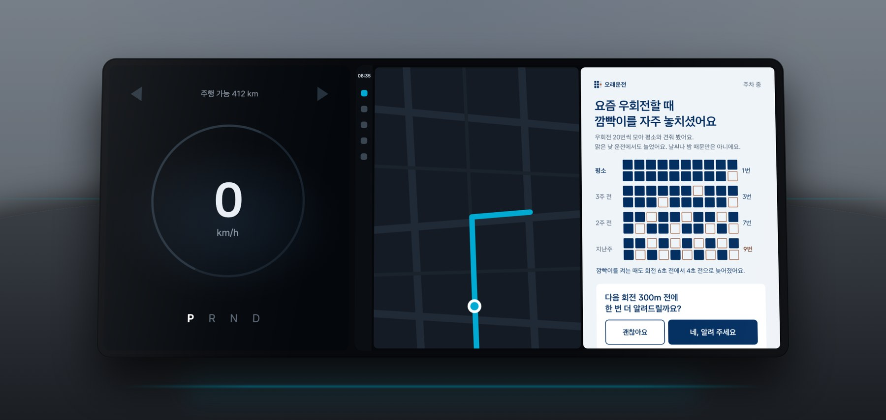</td>
<td>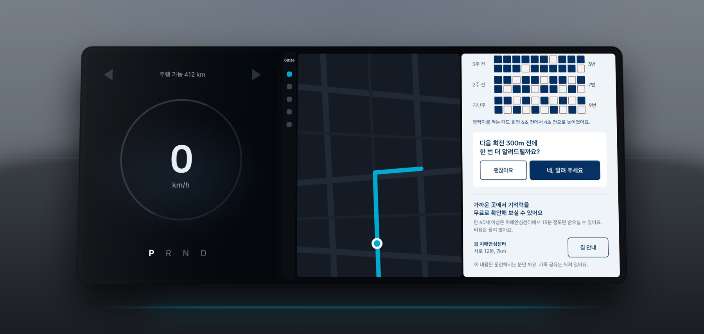</td>
</tr>
<tr>
<td><b>변화 안내</b><br>평소보다 자주 놓치면 본인에게 먼저. 칸 하나가 회전 한 번, 빈 칸이 놓친 회전</td>
<td><b>다음 할 일</b><br>만 60세 이상이면 가까운 치매안심센터 무료 검사와 길 안내를 열어 둔다</td>
</tr>
<tr>
<td>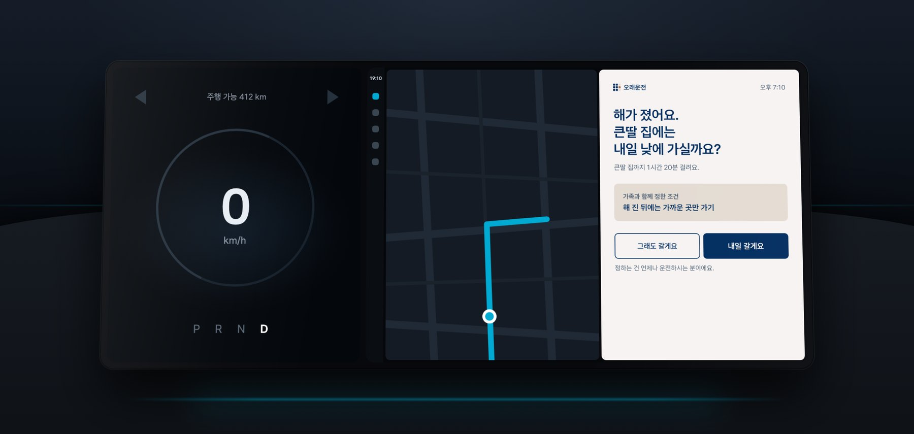</td>
<td>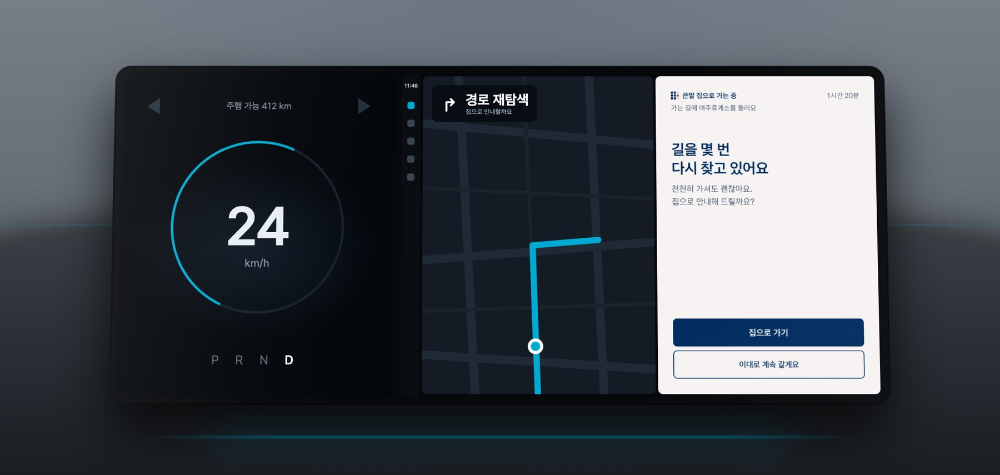</td>
</tr>
<tr>
<td><b>함께 정한 조건이 작동</b><br>해 진 뒤 먼 곳이면 "내일 낮에 가실까요?" 막지 않고 제안만</td>
<td><b>길 헤맴 감지</b><br>늘 다니던 길에서 경로를 몇 번 다시 찾으면 "집으로 안내해 드릴까요?"</td>
</tr>
<tr>
<td>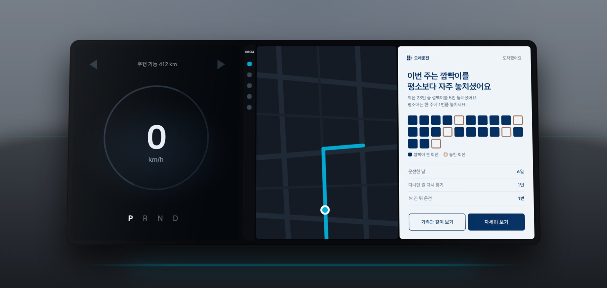</td>
<td>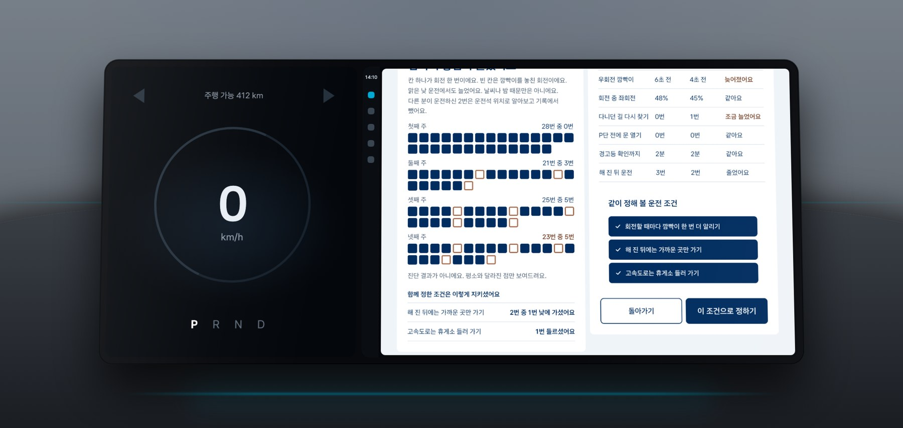</td>
</tr>
<tr>
<td><b>도착하면</b><br>이번 주 회전 기록을 한 장으로</td>
<td><b>조건 지킨 기록</b> (가로 2칸)<br>"2번 중 1번 낮에 가셨어요" 탓하지 않고 횟수만</td>
</tr>
</table>

<sub>앱 화면은 Pleos Connect 앱 창 크기(세로 1칸 920×1330, 가로 2칸 1870×1330) 에뮬레이터에서 찍은 실제 실행 화면이다. 둘레의 운전석과 계기판은 설명을 위해 그린 가상 목업이다.</sub>

### 움직이는 장면

<table>
<tr>
<td width="45%">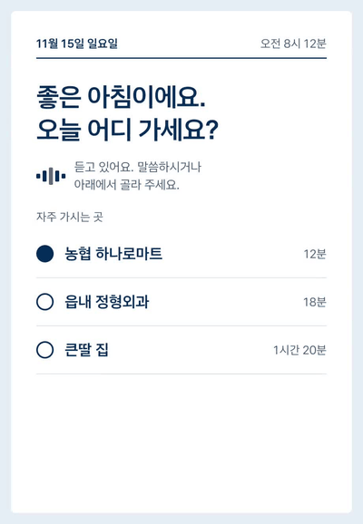</td>
<td>
<b>아침 장보기 (21초)</b><br><br>
1. 출발 인사: "오늘 어디 가세요?" 자주 가는 곳을 크게 보여 준다.<br>
2. 주행: 본인이 수락해 둔 조건대로 회전 200m 앞에서 "오른쪽 깜빡이를 켜 주세요".<br>
3. 도착 뒤: 최근 3주 놓침이 평소보다 늘었으면 본인에게 먼저, 수첩 칸으로 보여 준다.<br><br>
<sub>에뮬레이터 실제 화면(v0.4.0)을 녹화했다.</sub>
</td>
</tr>
</table>

## 왜 만들었나

| 사실 | 출처 |
| --- | --- |
| 65세 이상 운전자 교통사고 2025년 4만 5,873건, 2021년 대비 44% 증가 | 경찰청 집계 ([매일신문 2026.10.10](https://www.imaeil.com/page/view/2026101006531725206)) |
| 고령 운전자 면허 반납률 2021년 2.09%, 2025년 2.51%. 5년째 2%대 | 경찰청 자료 (같은 보도) |
| 야간·고속도로 운전을 제한하는 조건부 면허를 2027년 하반기 목표로 검토 중 | 경찰청 (같은 보도) |

반납만으로는 풀리지 않는다. 이동이 생계와 이어진 사람이 많기 때문이다. 질문은 "반납하느냐"가 아니라 "어떤 조건에서 계속 운전하느냐"로 바뀌고 있다. 그런데 지금 판단 도구는 3년에 한 번 받는 인지능력 자가진단뿐이고, 실제 운전 행동은 보지 않는다.

## 무엇을 하나

| 기능 | 내용 |
| --- | --- |
| 출발 인사 | 시동을 걸면 "오늘 어디 가세요?"라고 묻고, 답하면 목적지가 정해진다 |
| 나만의 기준선 | 처음 4주가 본인의 평소. 그다음은 평소보다 달라졌을 때만 본인에게 먼저 알린다 |
| 누가 운전했나 | 출발할 때 운전석 위치로 본인인지 알아본다. 자녀가 몬 날은 기준선에서 빼고, 가족 화면에 몇 번 뺐는지 적는다 |
| 날씨·밤 가리기 | 와이퍼와 해 지는 시각으로 회전마다 맑은 낮·비 오는 날·해 진 뒤를 남긴다. 맑은 낮에도 늘었는지 따로 견줘 날씨 탓인지 가린다 |
| 깜빡이 켜는 때 | 놓치기 전에 먼저 늦어지는지, 회전 몇 초 전에 켜는지를 평소와 견준다. 좌회전 비율도 같이 본다 |
| 깜빡이 알림 | 본인이 수락하면 회전 200m 앞에서 "오른쪽 깜빡이를 켜 주세요" |
| 가족과 같이 보기 | 가족이 동승했을 때 주차 중에 최근 4주 기록을 함께 보고 운전 조건을 정한다 |
| 조건이 작동 | 해 진 뒤 먼 곳이면 "내일 낮에 가실까요?", 고속도로는 휴게소를 경유지로. 막지 않고 제안만 한다 |
| 조건 지킨 기록 | 다음에 가족과 볼 때 "2번 중 1번 낮에 가셨어요"처럼 함께 정한 조건을 지킨 횟수를 보여준다 |
| 길 헤맴 감지 | 늘 다니던 길에서 경로를 몇 번 다시 찾으면 "집으로 안내해 드릴까요?" |
| 다음 할 일 잇기 | 변화를 알린 뒤 만 60세 이상이면 가까운 치매안심센터의 무료 검사를 알리고 길 안내를 열어 둔다 |

칸 하나가 회전 한 번이다. 채운 남색 칸은 깜빡이를 켠 회전, 금색 테두리만 있는 빈 칸은 놓친 회전이다. 색과 모양 둘 다로 구분된다.

> [!TIP]
> **왜 휴대폰이 아니라 차여야 하나.** 방향지시등, 기어, 문, 경고등 신호는 차 안에서만 정확히 얻을 수 있고, 내비 회전 안내와 실제 조작을 같은 시각에 맞춰 볼 수 있는 곳은 차량 OS뿐이다. 단말기를 달거나 휴대폰을 켤 필요 없이 시동만 걸면 동작한다.

## 디자인

현대차 광고 "Brilliant Moments"(인도, 두 편 각각 유튜브 2억 뷰)와 "Live Brilliant"가 담은 일상의 빛나는 순간, 맑은 낮에서 출발했다. 오래운전은 점수표가 아니라 평생 써 온 운전 수첩처럼 보이게 했다.

- **운전 수첩**: 회전 한 번이 도장 한 칸이다. 찍힌 칸은 Hyundai Blue, 깜빡이를 놓친 회전은 금색 테두리의 빈 칸으로 남는다. 금색은 이 빈 칸에만 쓴다.
- **맑은 낮**: 바탕은 Sky Blue를 옅게 깐 #EFF4F9, 카드는 흰 종이. 고령 운전자가 읽기 쉽게 진한 남색 글자와 큰 글씨(본문 최소 26)를 유지했다.
- **가족과 같이 보기**: 가로 2칸 화면에 펼친 앨범처럼 왼쪽 장은 4주 기록, 오른쪽 장은 습관·함께 정할 조건.
- 서체는 Pleos 공식 Asta Sans.

## 시스템 구조

차량 신호는 하나의 공급원(`VehicleSignalSource`)으로 모이고, 판정은 화면과 분리된 엔진이 한다. 깜빡이 누락 판정은 집중잔량과 같은 코드를 쓴다. 시연용 데이터와 실제 Pleos SDK를 같은 인터페이스로 바꿔 끼우므로 엔진과 화면은 그대로 쓴다. 점선은 아직 연결 전인 부분이다.

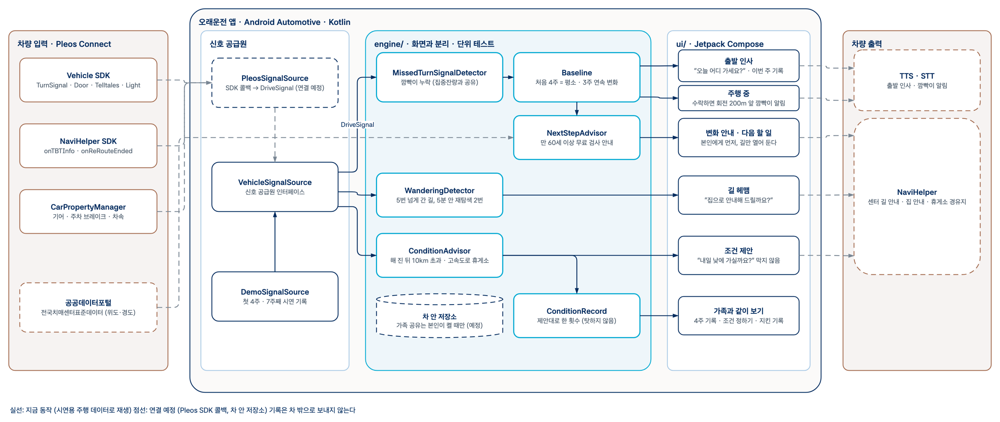

<sub>diagrams.net으로 그렸다. 원본 <a href="docs/architecture.drawio">docs/architecture.drawio</a>는 <a href="https://app.diagrams.net">app.diagrams.net</a>에서 파일 › 열기로 바로 고칠 수 있다.</sub>

### 변화는 이렇게 알린다

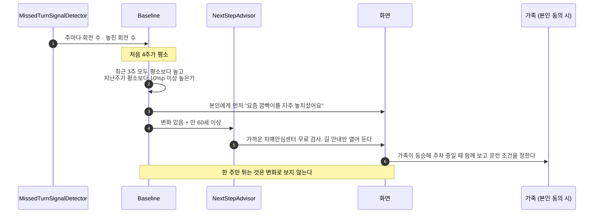

<details>
<summary><b>폴더 구조</b></summary>

```
app/src/main/java/com/botdue/orae/
├── engine/                        판정 엔진 (화면과 분리, 단위 테스트 대상)
│   ├── DriveSignal.kt             차량 신호 모델: 회전 안내, 방향지시등, 회전 통과, 운전석 위치, 와이퍼
│   ├── MissedTurnSignalDetector   깜빡이 누락 판정 (집중잔량과 공유), 켠 때·운전자·여건도 남김
│   ├── Baseline.kt                나만의 기준선과 변화 판정, 맑은 낮 비교, 깜빡이 켜는 때, 좌회전 비율
│   ├── DriverMatcher.kt           운전석 위치로 본인·다른 가족 가리기
│   ├── SunClock.kt                위치와 날짜로 해 뜨고 지는 시각 계산
│   ├── Conditions.kt              함께 정한 조건을 출발에 적용, 지킨 기록
│   ├── WanderingDetector.kt       길 헤맴 감지
│   ├── NextStep.kt                변화 다음 할 일 (무료 검사 안내)
│   └── VehicleSignalSource.kt     신호 공급원 인터페이스와 시연용 데이터
├── ui/                            Jetpack Compose 화면 (현대차 CI 색, Asta Sans, 고령자용 큰 글씨)
└── MainActivity.kt                화면 흐름
```

</details>

<details>
<summary><b>Pleos SDK 연결 계획</b></summary>

| 신호 | API |
| --- | --- |
| 방향지시등 | `TurnSignal.registerTurnSignalState()` |
| 회전 안내, 경로 재탐색 | `NaviHelperEventListener.onTBTInfo()`, `onReRouteEnded()` |
| 문, 경고등, 전조등 | `Door.registerDoorPosition()`, `Safety.registerTelltales()`, `Light.registerLowBeamLightState()` |
| 운전석 위치, 와이퍼 | `Seat.getCurrentSeatForeAftPosition()`, `Wiper.registerWiperState()` |
| 해 지는 시각 | FusedLocation 위치 + `SunClock` (인터넷 없이 계산) |
| 기어(P단), 주차 브레이크, 차속 | AAOS `CarPropertyManager` (GEAR_SELECTION, PARKING_BRAKE_ON, PERF_VEHICLE_SPEED) |
| 출발 인사, 깜빡이 알림 | STT / TTS |
| 휴게소 경유 | NaviHelper 경유지·경로 옵션 |
| 가까운 치매안심센터 | 공공데이터포털 [전국치매센터표준데이터](https://www.data.go.kr/data/15021138/standard.do) (위도·경도), 길 안내는 NaviHelper |

`VehicleSignalSource` 를 구현한 `PleosSignalSource` 를 추가하면 화면과 엔진은 그대로 쓴다.

</details>


## 판정 규칙

판정은 엔진(`app/src/main/java/com/botdue/orae/engine/`)이 한다. 모든 규칙에 단위 테스트가 있다.

1. **깜빡이 누락**: 내비가 회전을 안내하고(`NaviHelper onTBTInfo`) 90초 안에 같은 방향으로 회전했을 때, 회전 직전 10초 안에 같은 방향 깜빡이(`Vehicle TurnSignal`)가 켜지지 않았으면 놓침. 안내 없는 회전은 판정하지 않는다.
2. **나만의 기준선**: 처음 4주 기록이 평소. 남과 비교하거나 점수로 판정하지 않는다.
3. **변화**: 최근 3주가 모두 평소보다 높고, 지난주가 평소보다 10%p 이상 높을 때만 알린다. 한 주만 튀는 것은 변화로 보지 않는다.
4. **조건 적용**: "해 진 뒤에는 가까운 곳만"이면 18~6시에 10km가 넘는 출발에 낮에 가기를 제안한다. "고속도로는 휴게소 들러 가기"면 첫 휴게소를 경유지로 넣는다. 제안마다 제안대로 했는지(낮에 가기를 골랐는지, 휴게소를 지나 도착했는지)를 남겨 조건별로 센다. 지키지 않은 것을 탓하지 않고 횟수만 보여준다.
5. **길 헤맴**: 이 목적지로 5번 이상 다녀온 길에서 5분 안에 경로 재탐색(`onReRouteEnded`)이 2번 나오면 집 안내를 제안한다.
6. **다음 할 일**: 3번의 변화가 있고 운전자가 만 60세 이상이면 가장 가까운 치매안심센터 한 곳을 제안한다. 만 60세 이상은 소득과 상관없이 인지선별검사가 무료다. 가라고 권하지 않고 길만 열어 둔다.
7. **누가 운전했나**: 처음 20번 출발의 운전석 앞뒤 위치(`Seat`) 가운데값이 본인 자리. 그보다 6 넘게 다르면 다른 사람 운전으로 보고 그 출발의 회전은 평소에도 최근에도 넣지 않는다. 위치 값의 단위는 차종마다 달라 실차에서 맞춘다.
8. **날씨·밤 가리기**: 회전할 때 와이퍼(`Wiper`)가 돌면 비 오는 날, 해가 졌으면(위치와 날짜로 계산) 해 진 뒤, 아니면 맑은 낮. 3번의 변화가 잡히면 맑은 낮 회전만 평소와 최근 3주를 다시 견준다. 맑은 낮에도 10%p 넘게 늘었으면 "날씨나 밤 때문만은 아니에요", 아니면 늘어난 여건만 알린다. 최근 3주에 그 여건 회전이 8번이 안 되면 말하지 않는다.
9. **깜빡이 켜는 때**: 켠 회전마다 회전 몇 초 전에 켰는지 남긴다. 최근 3주의 주별 가운데값이 모두 평소보다 짧고, 지난주가 평소보다 1.5초 넘게 짧으면 늦어졌다고 본다. 좌회전 비율은 최근 3주 모두 평소보다 낮고 지난주가 10%p 넘게 낮으면 줄었다고 본다. 둘 다 진단이 아니라 평소 대비 변화를 보는 지표다.

## 실행

```bash
adb install apk/봇듀_오래운전_release.apk   # Pleos Connect Emulator(AAOS)
./gradlew :app:testDebugUnitTest            # 판정 엔진 테스트 35개
./gradlew :app:assembleRelease              # APK 빌드 (JDK 17)
```

차량 신호는 아직 시연용 주행 데이터로 재생한다. 시연에 쓰는 버튼은 다음과 같다.

- 출발 화면 아래: "첫 4주 기록 / 7주째 기록", "아침 출발 / 저녁 출발" 전환
- 주행 화면: "길 벗어나기"(경로 재탐색 대신), "도착했어요"(기어 P 신호 대신)

원하는 화면에서 바로 열기(화면 캡처·영상용):

```bash
adb shell am start -n com.botdue.orae/.MainActivity --es screen Family --ez conds true --ez kept true
# screen: Greeting · Advice · Driving · Parked · Change · Family
# --ei place 2  큰딸 집 (길 헤맴 시연은 Driving에서 "길 벗어나기" 두 번)
# --ez evening true  저녁 출발 (Advice: 해 진 뒤 먼 곳)
```

## 현재 상태

- [x] 화면 6종과 판정 엔진, 단위 테스트 17개 (v0.1.0)
- [x] Pleos 앱 창 크기 에뮬레이터에서 동작 확인, 시연 영상
- [x] 변화 다음 할 일: 가까운 치매안심센터 무료 검사 안내, 테스트 21개 (v0.2.0)
- [x] 조건 지킨 기록, 테스트 23개 (v0.3.0)
- [x] 디자인 "맑은 낮 운전 수첩": 하늘색 바탕, 흰 종이 카드, 펼친 앨범 (v0.4.0)
- [x] 시연 영상 v6: v0.4.0 화면으로 다시 녹화
- [x] 기준선 정확도: 운전석 위치로 다른 가족 운전 빼기, 맑은 낮·비·해 진 뒤 가리기, 깜빡이 켜는 때·좌회전 비율, 테스트 35개 (v0.5.0)
- [ ] 시연 영상과 움직이는 장면을 v0.5.0 화면으로 다시 녹화 (차 안 목업 4장은 v0.5.0으로 교체함)
- [ ] Pleos Connect Emulator에서 SDK 콜백 연결 (`PleosSignalSource`)
- [ ] STT·TTS 음성, 휴게소 경유지 실제 설정, 로컬 DB 저장
- [ ] 몇 주치 주행을 빠르게 재생하는 시연 도구 (2차 PT용)

자세한 진행은 [개발일지](docs/개발일지.md)에 있다.

## 원칙

> [!IMPORTANT]
> - 운전 기록은 차 안에만 저장한다. 가족 공유는 본인이 켰을 때만 한다.
> - 운전 습관의 변화를 보여줄 뿐 의학적 진단이 아니다. "진단", "판정" 같은 말은 화면에 쓰지 않는다.
> - 운전을 막지 않는다. 제안만 하고, 고르는 건 언제나 운전자 본인이다.

## 라이선스

글꼴 Asta Sans: SIL Open Font License 1.1
